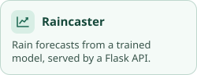

I’m a developer from Vietnam. I build mobile apps with Kotlin, Flutter, and React Native, along with web apps, APIs, and tools for macOS. I’ve also worked on rain prediction and a 2D puzzle platformer.

**[↗ Portfolio](https://thanhng224.github.io/react-portfolio/)** · [💼 LinkedIn](https://www.linkedin.com/in/nguy%E1%BB%85n-ph%C3%BAc-th%C3%A0nh-a7a8b3355/) · [✉️ Email](mailto:thanhng224@gmail.com)

## A few projects

Tools I work with

- **Mobile** · Kotlin, Java, Jetpack Compose, Flutter, React Native
- **App starters** · [Android / Compose](https://github.com/ThanhNg224/kotlin-android-mvvm-template2) · [Flutter](https://github.com/ThanhNg224/FlutterCoreBase) · [React Native / Expo](https://github.com/ThanhNg224/ReactNativeCoreBase)
- **Web** · React, Next.js, Tailwind CSS
- **Backend and data** · Node.js, Flask, Firebase, Firestore, SQL Server, MySQL, MongoDB
- **Desktop** · Swift, macOS
- **Data and games** · Python, scikit-learn, Unity, Blender
- **Version control** · Git

