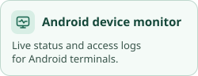
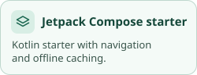
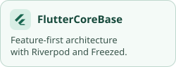

I’m a developer from Vietnam. I build Android and Flutter apps, along with web apps and APIs. I’ve worked on verification systems, education apps, and real-time device monitoring.

**[↗ Portfolio](https://thanhng224.github.io/react-portfolio/)** · [💼 LinkedIn](https://www.linkedin.com/in/nguy%E1%BB%85n-ph%C3%BAc-th%C3%A0nh-a7a8b3355/) · [✉️ Email](mailto:thanhng224@gmail.com)

## A few projects

  

Tools I work with

- **Mobile** · Kotlin, Java, Jetpack Compose, Flutter, React Native
- **Web** · React, Next.js, Tailwind CSS
- **Backend and data** · Node.js, Flask, Firebase, Firestore, SQL Server, MySQL, MongoDB
- **Other tools** · Git, Python, Unity, Blender

